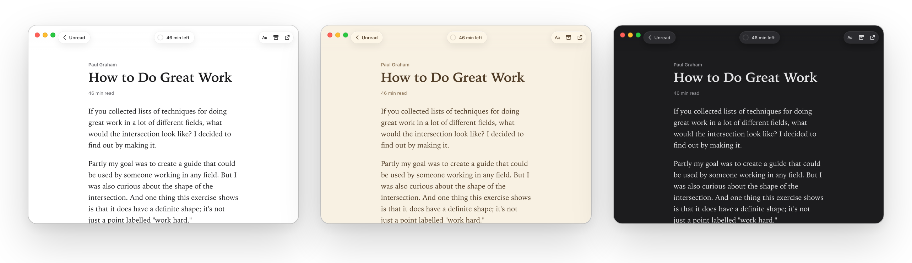
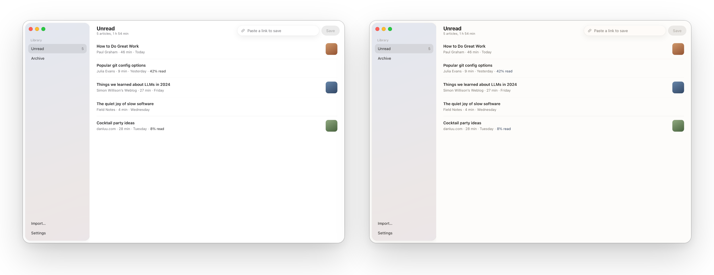

<p align="center">
  
</p>

<h1 align="center">Readbox</h1>

<p align="center">
  <b>A calm read-later app for Mac and Windows.</b><br>
  Save articles, read them later, even offline. No account, no server, no ads.
</p>

<p align="center">
  <a href="https://github.com/anon5376/readbox/releases/latest"></a>
  &nbsp;
  <a href="https://github.com/anon5376/readbox/releases/latest"></a>
</p>

<p align="center">
  <sub>Free and open source &nbsp;·&nbsp; macOS 11 or later, Apple Silicon and Intel &nbsp;·&nbsp; Windows 10 and 11 &nbsp;·&nbsp; <a href="https://github.com/anon5376/readbox/releases/latest">all downloads</a></sub>
</p>

<br>

<picture>
  <source media="(prefers-color-scheme: dark)" srcset="docs/hero-dark.png">
  
</picture>

## Why Readbox

Pocket shut down. Omnivore shut down. Readbox can't, because there's nothing to shut down: no company servers, no account, no subscription.

- **Your library is a folder of plain files.** Put it in iCloud Drive, Dropbox or OneDrive to sync between computers. The files open without the app.
- **Nothing leaves your computer.** No tracking, no analytics.
- **Saves the page as you see it.** The browser extension keeps articles you're logged into, pictures included, for reading offline.
- **Bring your old list.** Imports from Pocket, Omnivore and Instapaper, keeping dates and what you'd archived.
- **Small and quick.** Under 7 MB to download, built with [Tauri](https://tauri.app) instead of a bundled copy of Chrome.

## Made for reading

<p align="center">
  
</p>

- **White, sepia or night pages**, or let the page follow your computer's light and dark mode.
- **Your size, font and line width**, from the **Aa** button while you read.
- **Reading times that fit you.** Readbox learns how fast you read from your first 10 articles, then uses your speed everywhere.
- **Picks up where you left off**, and shows how many minutes are left.

## Two styles

<p align="center">
  
</p>

<p align="center"><b>Graphite</b>, in Apple's greys and black, and <b>Ink</b>, warm paper white with ink blue.<br>Both come in light and dark. Switch in <b>Settings → General → Style</b>.</p>

## Install

1. Download Readbox from **[Releases](https://github.com/anon5376/readbox/releases/latest)**: the `.dmg` for Mac or the `-setup.exe` for Windows.
2. Readbox isn't signed with a paid developer certificate yet, so your computer asks once:
   - **Mac:** drag Readbox into Applications and open it. When macOS says it can't check the app, go to **System Settings → Privacy & Security**, scroll down and click **Open Anyway**.
   - **Windows:** if SmartScreen appears, click **More info → Run anyway**.
3. Optional: add the [browser extension](#browser-extension) to save pages with one click.

> [!NOTE]
> **Early days (0.1).** Saving, importing, the reading list and the reader all work, but expect rough edges. Please [report anything that breaks](https://github.com/anon5376/readbox/issues).
>
> **Built with AI.** Most of the code is written by AI coding agents, directed and tested by a human.

## Browser extension

Saves the page you're looking at, exactly as you see it, so articles behind a login save properly. It sends the page only to the Readbox app on your own computer.

- Click the Readbox button in the toolbar, or press **Alt+Shift+S**.
- Right-click a page or a link for **Save page / Save link to Readbox**.
- The button shows **✓** when saved, or **!** with a notification if something went wrong (usually: the app isn't open).

<details>
<summary><b>How to install it</b></summary>
<br>

The extension isn't in the browser stores yet. Download `Readbox-browser-extension.zip` from [Releases](https://github.com/anon5376/readbox/releases/latest) and unzip it, or use the `extension` folder of this repository.

**Chrome, Brave, Edge, Helium, Arc:** open `chrome://extensions`, turn on **Developer mode**, click **Load unpacked** and pick the unzipped folder.

**Firefox:** open `about:debugging#/runtime/this-firefox`, click **Load Temporary Add-on** and pick `manifest.json` in the unzipped folder. Firefox removes it when it restarts, until the extension is published.

How it talks to the app: Readbox listens on `127.0.0.1:47612` and only accepts JSON requests from browser extensions, so websites can't add things to your library.

</details>

## More

<details>
<summary><b>Using Readbox</b></summary>
<br>

- Paste a link into the box at the top, or press ⌘V / Ctrl+V anywhere in the window, to save it.
- Click an article to read it. **Aa** changes text size, font, width and page colour. Esc goes back.
- Archive what you've read. Delete moves an article to the system Trash.
- **Settings** has the appearance and style, your library folder, reading options, your reading speed and the import.
- On a Mac, closing the window keeps Readbox running in the Dock, so the extension can still save. ⌘Q quits.

</details>

<details>
<summary><b>Moving from Pocket, Omnivore or Instapaper</b></summary>
<br>

Open **Settings → Import → Choose File…** and choose the file you downloaded from them: Pocket's `.csv`, `.zip` or `.html`, Omnivore's `.zip`, or Instapaper's `.csv`.

Readbox keeps each article's original date, whether you'd archived it, and Omnivore's reading position. It uses the article text from Omnivore exports and downloads everything else. Articles that are gone from the web are kept as a title and link. `samples/pocket-sample.csv` is a small file to try it with.

</details>

<details>
<summary><b>The library folder</b></summary>
<br>

By default it's `Documents/Readbox Library`:

```text
Readbox Library/
  articles/
    how-to-do-great-work-1a2b3c4d/
      meta.json      title, link, saved date, read/archived, reading position
      article.html   the cleaned article
      images/        pictures, downloaded when you save
```

Every article is its own folder, so syncing two computers rarely conflicts.

</details>

<details>
<summary><b>Development</b></summary>
<br>

Needs [Node.js](https://nodejs.org) and [Rust](https://rustup.rs).

```bash
npm install
npm run tauri dev    # run the app
npm test             # frontend tests
npm run design       # the interface with sample articles at http://localhost:1430/design-preview.html
scripts/screenshots.sh out/   # screenshots of every screen (needs npm run design and Chrome)
npm run ui-check     # every button reacts to the pointer; reader widths differ (needs npm run design and Chrome)
scripts/app-screenshot.sh app.png   # the real Mac window, on an empty test library (needs a debug build)
cd src-tauri && cargo test   # library/storage tests
```

</details>

## Credits

Article cleaning uses Mozilla's [Readability](https://github.com/mozilla/readability), the engine behind Firefox's reader view, and [DOMPurify](https://github.com/cure53/DOMPurify).

The interface uses the Segmented Control from [affectUI](https://www.affectui.com) (MIT) and animations adapted from [Rare UI](https://rareui.com): Animated Counter, Bounce Sidebar, Delete Button and Scroll Progress, toned down and rewritten in CSS, under Rare UI's MIT + Commons Clause + Attribution licence in `src/components/rareui/LICENSE`.

## License

[MIT](LICENSE)
