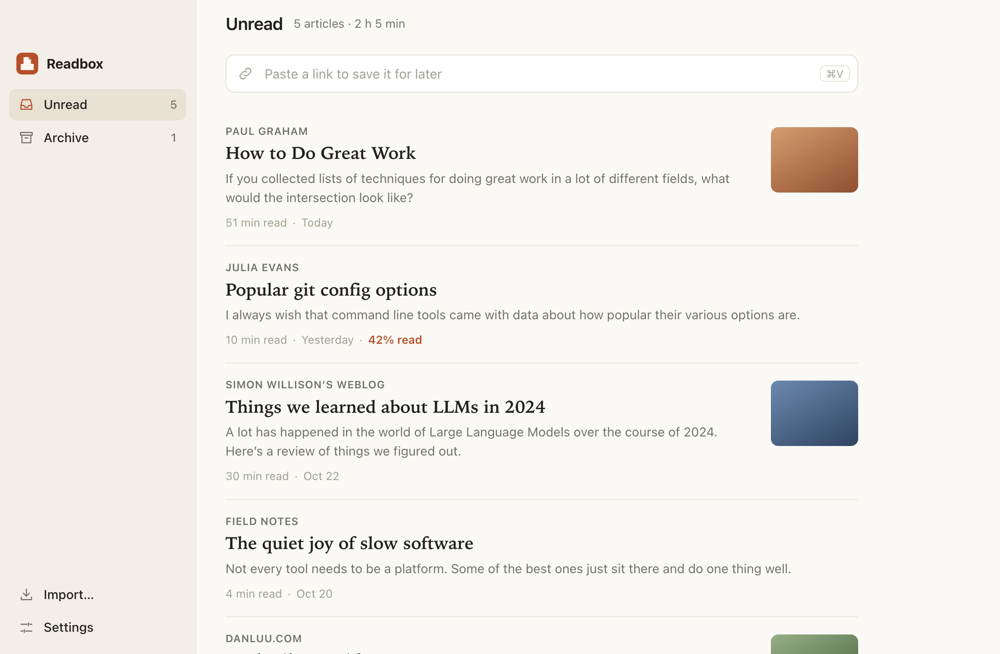
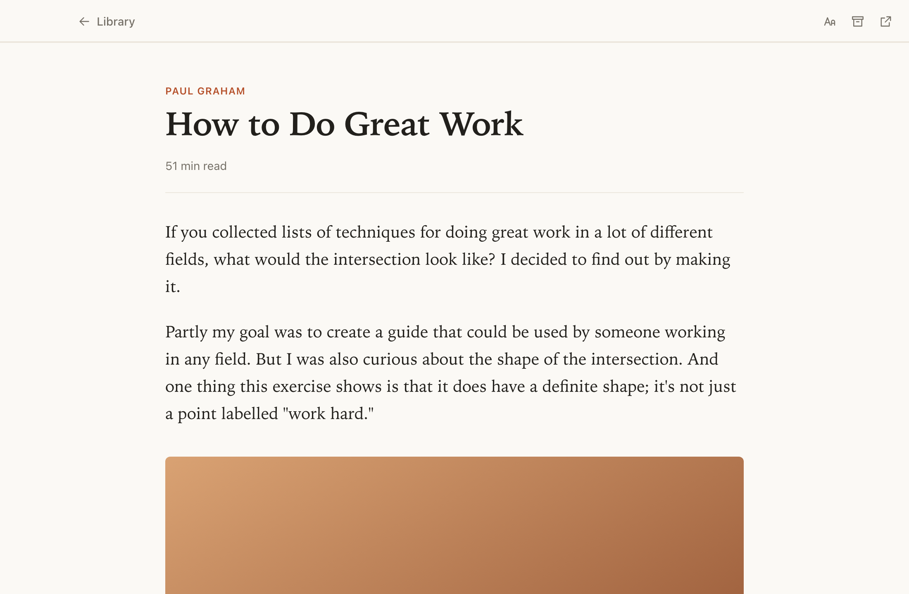

# Readbox (working name)

A calm read-later app for Mac and Windows. Save an article, read it later, offline, without ads or clutter.



- **No account, no server.** Nothing you save leaves your computer.
- **Your library is a folder of plain files.** Put it in Dropbox, iCloud Drive or OneDrive to sync between computers. You can open the files without the app.
- **Small and fast.** Built with [Tauri](https://tauri.app), not a bundled Chrome.

> **Status:** early. Saving (paste a link, or the browser extension), importing from Pocket, Omnivore and Instapaper, the reading list and the reader work. Windows builds come next.

> **Built with AI.** Most of the code is written by AI coding agents, directed and tested by a human. Bugs are likely at this stage; please open an issue.



## Using it

- Paste a link into the box at the top (or press ⌘V / Ctrl+V anywhere in the window) to save it.
- Click an article to read it. **Aa** changes text size, font, width and theme. Esc goes back.
- Archive what you've read; Delete moves an article to the system Trash.
- **Settings** shows where your library lives and lets you pick another folder.
- On a Mac, closing the window keeps Readbox running in the Dock (so the extension can save); ⌘Q quits.

## Moving from Pocket, Omnivore or Instapaper

Open **Settings → Import from Pocket, Omnivore or Instapaper…** and choose the file you downloaded from them (Pocket's `.csv`/`.zip`/`.html`, Omnivore's `.zip`, Instapaper's `.csv`). Readbox keeps each article's original date, whether you'd archived it, and Omnivore's reading position. It uses the article text from Omnivore exports and downloads everything else; articles that are gone from the web are kept as a title and link. `samples/pocket-sample.csv` is a small file to try it with.

## Browser extension

The extension saves the page you're looking at, exactly as you see it, so articles you're logged into save properly. It sends the page only to the Readbox app on your own computer.

- Click the Readbox button in the toolbar, or press **Alt+Shift+S**.
- Right-click a page or a link for **Save page / Save link to Readbox**.
- The button shows **✓** when saved and **!** with a notification if something went wrong (usually: the app isn't open).

**Install (Chrome, Brave, Edge, Helium, Arc):** open `chrome://extensions`, turn on **Developer mode**, click **Load unpacked** and pick the `extension` folder.

**Firefox:** open `about:debugging#/runtime/this-firefox`, click **Load Temporary Add-on** and pick `extension/manifest.json`. Firefox removes it when it restarts until the extension is published.

How it talks to the app: Readbox listens on `127.0.0.1:47612` and only accepts JSON requests from browser extensions, so websites can't add things to your library.

## The library folder

By default it's `Documents/Readbox Library`:

```text
Readbox Library/
  articles/
    how-to-do-great-work-1a2b3c4d/
      meta.json      title, link, saved date, read/archived, reading position
      article.html   the cleaned article
      images/        pictures, downloaded when you save
```

Every article is its own folder, so syncing two computers rarely conflicts.

## Development

Needs [Node.js](https://nodejs.org) and [Rust](https://rustup.rs).

```bash
npm install
npm run tauri dev    # run the app
npm test             # frontend tests
npm run design       # the interface with sample articles at http://localhost:1430/design-preview.html
scripts/screenshots.sh out/   # screenshots of every screen (needs npm run design and Chrome)
cd src-tauri && cargo test   # library/storage tests
```

Article cleaning uses Mozilla's [Readability](https://github.com/mozilla/readability) (the engine behind Firefox's reader view) and [DOMPurify](https://github.com/cure53/DOMPurify).

## License

[MIT](LICENSE)
