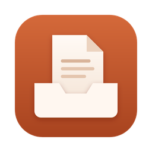
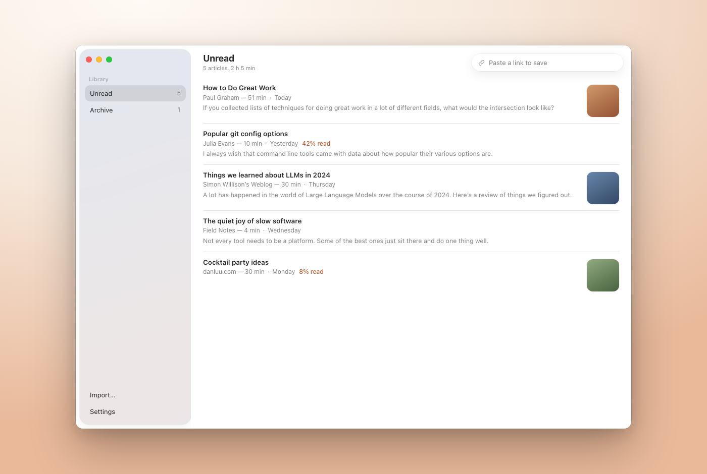
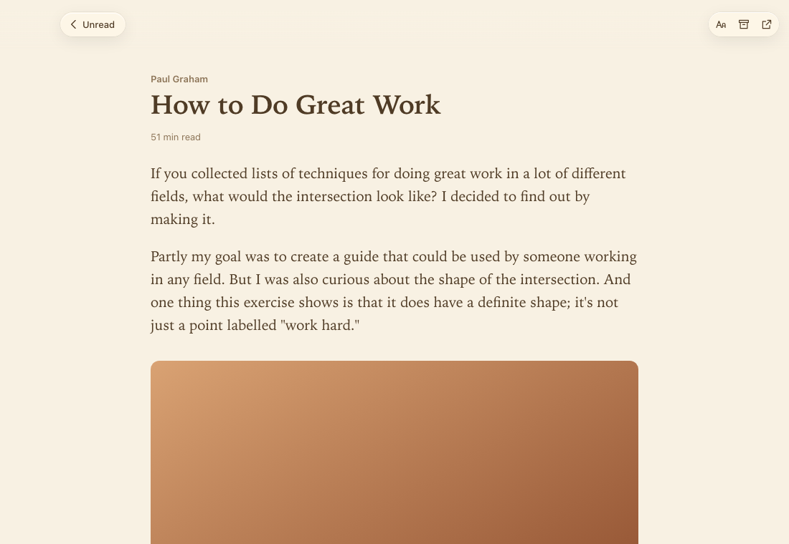
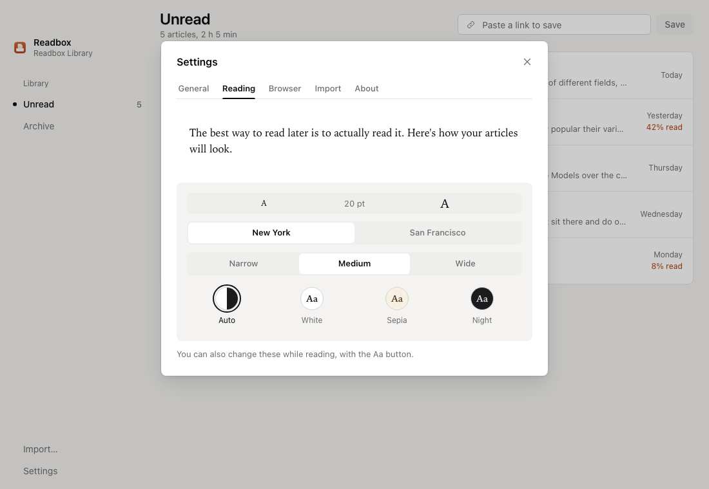

<p align="center">
  
</p>

<h1 align="center">Readbox</h1>

<p align="center">
  <b>A calm read-later app for Mac and Windows.</b><br>
  Save articles, read them later, even offline. No account, no server, no ads.
</p>

<p align="center">
  <a href="https://github.com/anon5376/readbox/releases/latest"></a>
  
  <a href="LICENSE"></a>
</p>

<p align="center">
  <a href="https://github.com/anon5376/readbox/releases/latest"><b>Download for Mac</b></a> (.dmg)
  &nbsp;·&nbsp;
  <a href="https://github.com/anon5376/readbox/releases/latest"><b>Download for Windows</b></a> (.exe)
</p>

<picture>
  <source media="(prefers-color-scheme: dark)" srcset="docs/hero-dark.png">
  
</picture>

## Why Readbox

Pocket shut down. Omnivore shut down. Readbox can't, because there's nothing to shut down: no company servers, no account, no subscription.

- **Your library is a folder of plain files.** Put it in iCloud Drive, Dropbox or OneDrive to sync between computers. You can open the files without the app.
- **Nothing leaves your computer.** No tracking, no analytics.
- **Saves the page as you see it.** The browser extension keeps articles you're logged into, with their pictures, for reading offline.
- **Bring your old list.** Imports from Pocket, Omnivore and Instapaper, keeping dates and what you'd archived.
- **Small and fast.** About 3 MB, built with [Tauri](https://tauri.app) instead of a bundled Chrome.

<table>
  <tr>
    <td width="50%"></td>
    <td width="50%"></td>
  </tr>
  <tr>
    <td align="center">A clean reader: white, sepia or night pages</td>
    <td align="center">Pick the size, font and line width</td>
  </tr>
</table>

## Install

1. Download the latest version from **[Releases](https://github.com/anon5376/readbox/releases/latest)**: the `.dmg` for Mac (Apple Silicon and Intel) or the `-setup.exe` for Windows.
2. Readbox isn't signed with a paid developer certificate yet, so your computer asks once:
   - **Mac:** drag Readbox into Applications and open it. When macOS says it can't check the app, go to **System Settings → Privacy & Security**, scroll down and click **Open Anyway**.
   - **Windows:** if SmartScreen appears, click **More info → Run anyway**.
3. Optional: add the [browser extension](#browser-extension) to save pages with one click.

> **Status: early (0.1).** Saving, importing, the reading list and the reader work. Bugs are likely; please [open an issue](https://github.com/anon5376/readbox/issues).
>
> **Built with AI.** Most of the code is written by AI coding agents, directed and tested by a human.

## Using it

- Paste a link into the box at the top (or press ⌘V / Ctrl+V anywhere in the window) to save it.
- Click an article to read it. **Aa** changes text size, font, width and theme. Esc goes back.
- Archive what you've read; Delete moves an article to the system Trash.
- **Settings** has the appearance (light or dark), your library folder, reading options and the import.
- On a Mac, closing the window keeps Readbox running in the Dock (so the extension can save); ⌘Q quits.

## Moving from Pocket, Omnivore or Instapaper

Open **Settings → Import → Choose File…** and choose the file you downloaded from them (Pocket's `.csv`/`.zip`/`.html`, Omnivore's `.zip`, Instapaper's `.csv`). Readbox keeps each article's original date, whether you'd archived it, and Omnivore's reading position. It uses the article text from Omnivore exports and downloads everything else; articles that are gone from the web are kept as a title and link. `samples/pocket-sample.csv` is a small file to try it with.

## Browser extension

The extension saves the page you're looking at, exactly as you see it, so articles you're logged into save properly. It sends the page only to the Readbox app on your own computer.

- Click the Readbox button in the toolbar, or press **Alt+Shift+S**.
- Right-click a page or a link for **Save page / Save link to Readbox**.
- The button shows **✓** when saved and **!** with a notification if something went wrong (usually: the app isn't open).

The extension isn't in the browser stores yet. Download `Readbox-browser-extension.zip` from [Releases](https://github.com/anon5376/readbox/releases/latest) and unzip it (or use the `extension` folder of this repository).

**Chrome, Brave, Edge, Helium, Arc:** open `chrome://extensions`, turn on **Developer mode**, click **Load unpacked** and pick the unzipped folder.

**Firefox:** open `about:debugging#/runtime/this-firefox`, click **Load Temporary Add-on** and pick `manifest.json` in the unzipped folder. Firefox removes it when it restarts until the extension is published.

How it talks to the app: Readbox listens on `127.0.0.1:47612` and only accepts JSON requests from browser extensions, so websites can't add things to your library.

## The library folder

By default it's `Documents/Readbox Library`:

```text
Readbox Library/
  articles/
    how-to-do-great-work-1a2b3c4d/
      meta.json      title, link, saved date, read/archived, reading position
      article.html   the cleaned article
      images/        pictures, downloaded when you save
```

Every article is its own folder, so syncing two computers rarely conflicts.

## Development

Needs [Node.js](https://nodejs.org) and [Rust](https://rustup.rs).

```bash
npm install
npm run tauri dev    # run the app
npm test             # frontend tests
npm run design       # the interface with sample articles at http://localhost:1430/design-preview.html
scripts/screenshots.sh out/   # screenshots of every screen (needs npm run design and Chrome)
npm run ui-check     # every button reacts to the pointer; reader widths differ (needs npm run design and Chrome)
scripts/app-screenshot.sh app.png   # the real Mac window, on an empty test library (needs a debug build)
cd src-tauri && cargo test   # library/storage tests
```

Article cleaning uses Mozilla's [Readability](https://github.com/mozilla/readability) (the engine behind Firefox's reader view) and [DOMPurify](https://github.com/cure53/DOMPurify).

The interface uses the Segmented Control from [affectUI](https://www.affectui.com) (MIT) and animations adapted from [Rare UI](https://rareui.com) (Animated Counter, Bounce Sidebar, Delete Button and Scroll Progress, toned down and rewritten in CSS, under Rare UI's MIT + Commons Clause + Attribution licence in `src/components/rareui/LICENSE`).

## License

[MIT](LICENSE)
